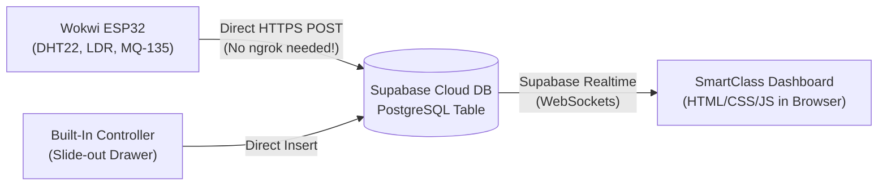

# 🏆 Hackathon Guide: SmartClass IoT on Supabase (Serverless)

> **No Node.js, No ngrok, No server setup required!**  
> The dashboard runs directly in your browser as pure static HTML/CSS/JS, and Wokwi talks directly to your free cloud database on **Supabase** via HTTPS.

---

## ⚡ How the System Works



---

## 🚀 5-Minute Setup for Hackathons

### Step 1: Create a Free Supabase Project (2 mins)
1. Go to **[supabase.com](https://supabase.com)** and sign in with GitHub (free).
2. Click **"New Project"**.
3. Name it: `smartclass` (set any database password).
4. Select your nearest region (e.g., *South Asia / Singapore / US*).
5. Click **"Create new project"** and wait ~1 minute for it to finish setting up.

---

### Step 2: Create the Database Table (30 seconds)
1. In your Supabase project dashboard, click on **SQL Editor** (icon `>_` on the left sidebar).
2. Click **"New Query"**.
3. Open the file [supabase_schema.sql](file:///c:/Users/khara/Downloads/srujan2.0/supabase_schema.sql) in this project folder, copy all its content, and paste it into the Supabase SQL Editor.
4. Click the green **"RUN"** button.
   *(You will see `Success. No rows returned` — your table `sensor_readings` and Realtime are now fully configured!)*

---

### Step 3: Copy Your Supabase API Keys (30 seconds)
1. In Supabase, click **Project Settings** (gear icon ⚙️ on bottom left) ➔ **API**.
2. Copy two values:
   - **Project URL** (e.g. `https://xyzabc12345.supabase.co`)
   - **Project API Keys ➔ `anon` `public`** (a long string starting with `eyJhbGci...`)

---

### Step 4: Connect the Dashboard (30 seconds)

Open the file [public/js/supabase-config.js](file:///c:/Users/khara/Downloads/srujan2.0/public/js/supabase-config.js) and paste your URL and key:

```javascript
const SUPABASE_CONFIG = {
  url: "https://your-project-id.supabase.co", // Your Project URL
  anonKey: "eyJhbGciOiJIUzI1NiIsInR5cCI6..."   // Your Anon Public Key
};
```

*(Alternatively: Simply open the dashboard in your browser, click the **Settings** tab on the left sidebar, paste your URL and key there, and click **"Save & Connect Supabase"**!)*

---

### Step 5: Connect Wokwi ESP32 (1 min)

1. Open **[wokwi.com/projects/new/esp32](https://wokwi.com/projects/new/esp32)**.
2. In the **`sketch.ino`** tab, paste the code from [wokwi/sketch.ino](file:///c:/Users/khara/Downloads/srujan2.0/wokwi/sketch.ino).
3. On **Line 14 & 15**, replace the placeholders with your Supabase URL and key:
   ```cpp
   String supabaseUrl = "https://your-project-id.supabase.co/rest/v1/sensor_readings";
   String supabaseKey = "eyJhbGciOiJIUzI1NiIsInR5cCI6...";
   ```
4. In the **`diagram.json`** tab, paste the circuit from [wokwi/diagram.json](file:///c:/Users/khara/Downloads/srujan2.0/wokwi/diagram.json).
5. In the **Library Manager** tab (book icon 📚 on the left in Wokwi), add:
   - `DHT sensor library for ESPx`
   - `ArduinoJson`

---

## 🎯 How to Run the Demo for Judges

1. **Open the Dashboard**:
   - Double-click [public/index.html](file:///c:/Users/khara/Downloads/srujan2.0/public/index.html) to open it directly in Chrome or Edge!
   - You can also host it on **GitHub Pages**, **Vercel**, or **Netlify** with 1 click for free.
2. **Start the Wokwi Simulation**:
   - In Wokwi, click the green **Play (▶)** button.
3. **Change Sensor Values**:
   - **Click the DHT22**: Slide the Temperature above 32°C ➔ Watch the dashboard card turn red and trigger the **High Temperature Alert** live!
   - **Click the LDR**: Drag the Lux slider ➔ Watch the **Light Level** card and yellow graph curve update!
   - **Turn the Potentiometer**: Rotate the dial ➔ Watch **Air Quality** update and see the live AI recommendation change!
4. **Offline / Fast Backup Demo**:
   - If hackathon venue WiFi is slow, click the purple floating button at the bottom-right of the dashboard: **"Wokwi Live Controller"**.
   - Move the sliders or click **"Start Auto Fluctuation"** — the dashboard animates and records directly to Supabase!
